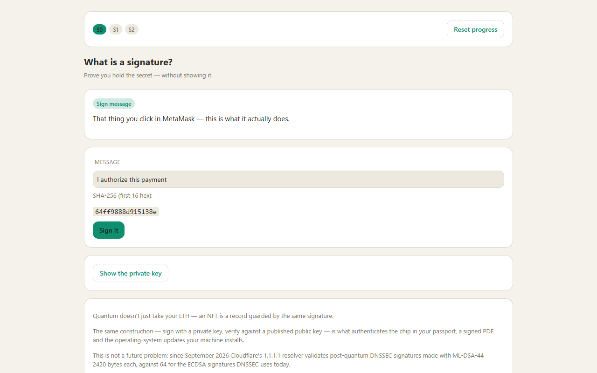
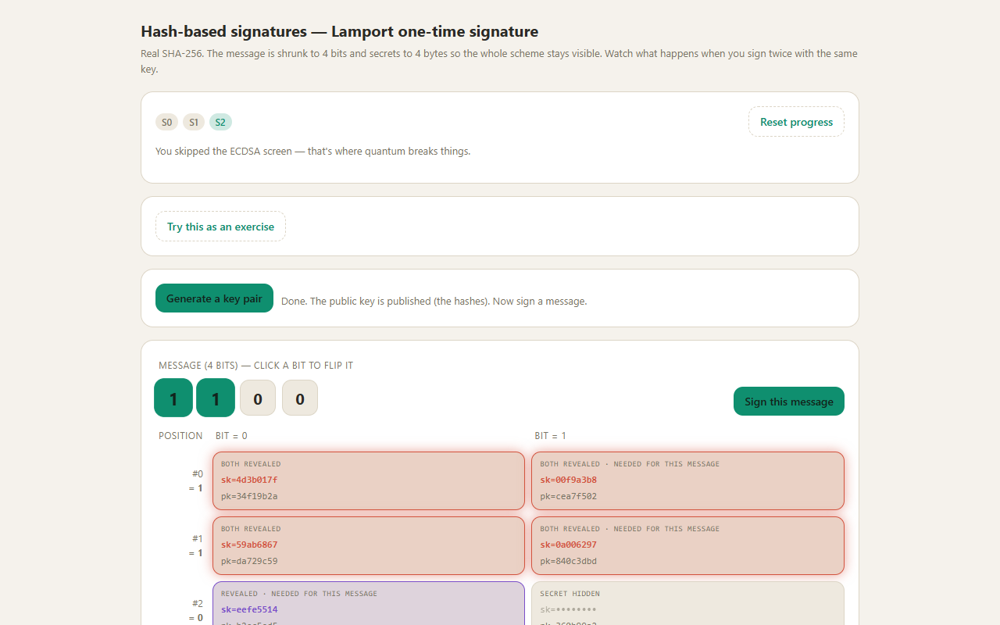

# The Signature Explorer

An interactive explainer of digital signatures, from ECDSA to post-quantum hash-based schemes.
For teachers of post-quantum cryptography, their students, and Ethereum engineers who want to see why signatures break and what replaces them.

The Signature Explorer walks through digital signatures with real code instead of diagrams: real ECDSA on secp256k1, ECDSA nonce reuse that leaks the private key, and a Lamport one-time signature that is forged after a single key reuse. From there it follows the post-quantum, hash-based path through XMSS and FORS to SPHINCS+ (standardised as SLH-DSA, FIPS 205). It is interactive, runs entirely in your browser, and has no backend.

**Live site: https://anaexplores.github.io/the-signature-explorer/**



<!-- hero GIF goes here -->

## One lens, three questions

Every scheme on the site is put through the same three questions:

1. What does the signature reveal?
2. What breaks it?
3. Is it quantum-safe?

For ECDSA the answers are: nothing about the private key until a nonce repeats; Shor's algorithm, nonce reuse, weak randomness; no. For Lamport and hash-based signatures: half of the secrets, exactly the bits the message needed; reuse, and little else; yes, because security reduces to the strength of the hash.

## The three screens

| Screen | File | What you can do |
|---|---|---|
| S0 What is a signature? | `index.html` | Sign a message, tamper with a character and watch verification fail, reveal the private key. Introduces the lens and ties it to what MetaMask does. |
| S1 Classic EC: ECDSA | `ecdsa.html` | Generate a secp256k1 key, sign, verify, tamper. Switch on an illustrated quantum computer. Reuse a nonce on purpose and recover the private key live from two signatures. |
| S2 Hash-based signatures | `hash.html` | Generate a Lamport key with real SHA-256 (4-bit messages, 4-byte secrets so everything stays visible). Sign twice with the same key, see which secrets leak, and forge a message nobody signed with the real verifier. Then follow three questions: remember which key you burned (XMSS and Merkle trees), tolerate a few repeats (FORS), remember nothing (SLH-DSA). |



## For teachers: exercises

S1 and S2 each have a "Try this as an exercise" panel.

- **T1, forge the target** (`hash.html`): using at most two signatures from one Lamport key, and without ever signing the target message, make the target forgeable.
- **T2, find the pair that leaks the key** (`ecdsa.html`): from five signatures, pick the two whose reused nonce lets you recover the private key.

Instances are generated deterministically from a seed, so everyone on the same seed gets the same task.

1. Open an exercise panel and choose "I'm an instructor".
2. Enter any text as the seed (or press "Random"). The panel builds the assignment link, for example `hash.html?task=s2-forge&seed=<seed>` or `ecdsa.html?task=s1-nonce&seed=<seed>`, resolved against the permanent address.
3. Send the link to the group. Students solve it in their browser and get a completion code of the form `SE1-XXXX-XXXX`.
4. To check a code, open the same instructor panel with the same seed, paste the code and press "Check code". It answers whether the code is valid for that assignment. No server, secret or stored state is involved.

Honest limit: a code proves that a valid solution exists for that exact seed. It does not prove who produced it. Everything runs in the student's browser and the source is open, so use the exercises for practice and low-stakes checks, not as proctored assessment.

## How this compares

Other people have built good material on this topic, and the comparison below is meant to be fair.

- **[Crypto Lab](https://crypto-lab.systemslibrarian.dev)** (Paul Clark; MIT-licensed demo repositories, under active development) is a collection of interactive browser demos covering much of the same ground. Its [ECDSA module](https://systemslibrarian.github.io/crypto-lab-ecdsa-forge/) recovers a private key from two signatures that share a nonce and shows RFC 6979 deterministic nonces as the mitigation; it supports secp256k1 and P-256. Its [post-quantum families module](https://systemslibrarian.github.io/crypto-lab-pq-families/) generates a real SHA-256 Lamport keypair in the browser and runs a key-reuse forgery that the real verifier accepts, on a deliberately truncated digest (12 to 20 bits) so the search finishes quickly. If you only want to try those two attacks, you can do that there, and it deserves credit for it.
- **pqcvisualizer** is an interactive comparison of post-quantum scheme sizes, not of how the schemes work or fail.
- **The NIST signature "zoo"** is a sortable reference table of signature schemes and parameter sets, with no animation of mechanics.
- **Matthew Green's posts** on hash-based and post-quantum signatures are well-regarded written primers. They are text, not interactive.

What is different here:

- One lens (the same three questions) applied across classical and post-quantum schemes, as a single storyline rather than a catalogue.
- A permanent, citable address, and a "Cite this page" block with ready-made citation text and BibTeX.
- Provenance for every factual claim: 26 claims, each traced to a primary source with an exact locator, checked by automated gates.
- An exercise track for teachers: seeded assignments and verifiable completion codes.

Details about other projects were checked against their public pages and repositories in October 2026; they may have changed since.

## How claims are verified

Every factual statement the site shows is an entry in the registry `js/data/claims.mjs`: 26 claims, each pointing to a primary source (an RFC, a FIPS standard, a vendor announcement) and an exact locator such as a section or algorithm number. A human-readable version is in `docs/PROVENANCE.md`.

The registry is kept honest by machine checks in `tools/checks/`:

- **K10, provenance gate.** Sub-checks include parity between the registry and the documentation, coverage of every claim rendered on screen, a recorded registry hash (any edit to the registry fails the check until the hash in `js/data/site.mjs` is updated, alongside the content version cited on the site), anchor uniqueness, and the release check.
- **K9, bundles in sync.** The committed bundles in `build/` must equal a fresh rebuild from source.
- **Smoke test** (`test/schemes.smoke.mjs`) on the real cryptography: valid Lamport and ECDSA signatures verify, forgeries do not, Lamport key reuse leaks secrets that yield forgeries, and ECDSA nonce reuse recovers the key.

## Known limitations

These are gaps in the checks themselves, found by deliberately breaking each gate. They are tracked, not hidden:

- **K7 (crypto stays in `js/schemes/` and `js/vendor/`) matches a fixed list of names** (`sha256`, `secp…`, `getRandomValues`, `BigInt`, `invert`). Crypto pulled into a screen through `crypto.subtle`, `hmac` or `sha3` is not detected.
- **The secret scan reads only files in the git index**, so a file that has not been `git add`ed yet is not scanned. In a repository with nothing staged it scans nothing and still reports success.
- **The secret scan also skips some file types by design**: HTML, CSS, SVG, the license files, `CITATION.cff`, `package-lock.json`, the generated bundles in `build/`, and images.

## Development

Requires Node.js 19 or newer.

```
npm install
npm run build          # rebuild the bundles in build/
npm run check          # K9: committed bundles match a fresh build
npm test               # crypto smoke test
npm run check:all      # all gates
npm run check:release  # full release gates, including the browser layout audit
npm run check:k5       # layout audit alone (headless browser)
```

The site runs straight from disk: open `index.html` in a browser. There is no server, no backend and no external requests. The bundles in `build/` are classic scripts, so `file://` works. Cryptography comes from the `@noble/curves` and `@noble/hashes` libraries, vendored in `js/vendor/`.

## License and citation

- Code: MIT, see `LICENSE`.
- Content (text, diagrams, screenshots): CC BY 4.0, see `LICENSE-CONTENT`.

To cite, use the project name and the permanent URL:

> The Signature Explorer (anaexplores). https://anaexplores.github.io/the-signature-explorer/

The site's "Cite this page" block provides the citation text and BibTeX. Repository metadata is in `CITATION.cff`.
